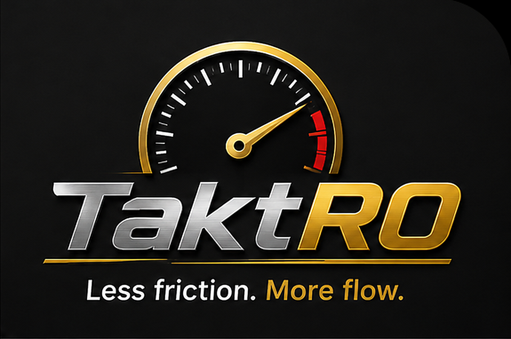

# TaktRO

<p align="center">
  
</p>

TaktRO is a local, keyboard-first automotive shop-management prototype. Write
repair orders, book work, receive and allocate parts, and follow a job through
posting and history. Customer records, vehicle details, inventory, and shop
setup live in SQLite databases controlled by the shop.

The current proof of concept runs on Linux in a GTK/WebKit window or a modern
browser. It demonstrates connected shop workflows; production readiness and
measured improvements in shop throughput remain to be established.

## Quick start

Once [installed](#installation), prepare a separate demo with fictional data:

```bash
python3 scripts/demo.py --db /tmp/taktro-demo.db
TAKTRO_DB_PATH=/tmp/taktro-demo.db TAKTRO_NHTSA_DB_PATH=/tmp/taktro-demo-reference.db python3 server.py
```

1. Open **http://127.0.0.1:8080** and sign in with demo administrator PIN **1042**.
2. Press **Shift+P**, find **DEMO-OIL-5L**, and receive two containers at $40 each.
3. Use **Alt+B** in the part detail to split one container into five child units,
   with a retail price of $12 per unit.
4. Press **Shift+O**, open **RO-DEMO-0001**, and apply four child units to its
   oil-service line. The demo already includes $50 of labor.
5. Follow the [portfolio walkthrough](compendium/PORTFOLIO_DEMO.md) to dispatch,
   complete, book, and post the job, then inspect it with **Shift+H**.

| Action | Result |
| --- | --- |
| Receive two containers | Parent stock becomes 2 |
| Split one container | Parent stock becomes 1; child stock becomes 5 |
| Confirm four child units on the RO | Four units are reserved; parts are $48 and the RO total is $98 |
| Remove / release confirmed parts before posting | The reservation is released and the parts charge is removed |
| Set the line to warranty (`W`) | The $98 moves to the warranty total; customer pay becomes $0 |
| Post the completed, booked RO | Child stock becomes 1, reservations clear, and the RO becomes read-only |
| Repeat the same post | Stock is not consumed twice |

The demo initializer refuses to overwrite existing databases. Choose a new
filename for another run, and use that filename in both commands. Stop the
server with **Ctrl+C** when finished.

### Keyboard navigation

Plain letters remain available for text entry. Use **Shift+Key** to move between
workspaces and the displayed **Alt** shortcuts for workspace actions.

| Key | Workspace or action |
| --- | --- |
| `Shift+O` | Repair orders |
| `Shift+A` | Appointments |
| `Shift+C` | Customers |
| `Shift+V` | Vehicles and equipment |
| `Shift+P` | Parts and inventory |
| `Shift+H` | Repair-order history |
| `Shift+K` | Vendors and contacts |
| `Shift+S` | Shop settings |
| `Shift+J` | Job operation codes |
| `Shift+M` | Staff and access |
| `Escape` | Close the active interaction or return through workspace history; lock the session from the dashboard |

See the [keybindings reference](compendium/KEYBINDINGS.md) for workspace commands
and the [workflow guide](compendium/WORKFLOW_GUIDE_v1.md) for the broader shop
process. The compendium also contains proposed workflows beyond this demo.

## Installation

You need Python 3.10+ and a modern browser. The core server uses Python's
standard library and SQLite; no Python packages or frontend build are required
for normal operation.

```bash
git clone https://github.com/RawLabs/TaktRO.git
cd TaktRO
./launch.sh
```

The launcher uses a GTK 3 / WebKit2 4.0 desktop window when the system Python
has the required PyGObject bindings. Otherwise it opens the default browser.
It starts the local server and stops it when the desktop window closes or the
browser-mode launcher exits.

On first launch, TaktRO creates its operational and reference databases and
seeds an administrator with PIN **1042**. Change that PIN in Staff & Access
before entering private records. The public repository includes source,
documentation, and brand assets; local shop databases are excluded.

To run only the server, use `python3 server.py` and open
`http://127.0.0.1:8080`. See the [development guide](compendium/DEVELOPMENT.md)
for desktop dependencies, database details, and diagnostic tools.

## Requirements for the current prototype

- Linux with Python 3.10+.
- A modern browser, or optional GTK 3, WebKit2 4.0, and PyGObject bindings for
  the native desktop shell.
- Writable local storage for the SQLite operational and reference databases.
- Internet access for live NHTSA VIN decoding, recalls, and reference downloads.
  The core repair-order and inventory workflow uses local data.
- For development checks: Node.js for JavaScript syntax validation; Playwright
  and the relevant browser engines for browser tests.

The [development guide](compendium/DEVELOPMENT.md) suggests a dual-core CPU,
4 GB RAM, a 1280 × 720 display, and 2 GB of free storage for evaluation.
A 1920 × 1080 display gives dense workspaces more room. Allow additional disk
space when importing the optional NHTSA communications archive; that dataset
is not bundled with the repository.

## Configuration and local data

By default, runtime databases are created alongside `server.py`. Use separate
paths for demos, testing, and private shop records.

| Variable | Purpose | Default |
| --- | --- | --- |
| `TAKTRO_DB_PATH` | Operational SQLite database | `taktro.db` in the project directory |
| `TAKTRO_NHTSA_DB_PATH` | NHTSA reference SQLite database | `nhtsa_reference.db` in the project directory |
| `TAKTRO_HOST` | Direct server bind address | `127.0.0.1` |
| `TAKTRO_PORT` | Direct server port | `8080` |
| `TAKTRO_DEV_MODE` | Server-side developer diagnostic routes; `0` disables them | Enabled |
| `LM_STUDIO_URL` | Optional incident-analysis endpoint | `http://localhost:1234/v1/chat/completions` |
| `LM_STUDIO_MODEL` | Optional local incident-analysis model | Automatically selected from available models when unset |

`launch.sh` chooses an available port for browser mode. The desktop shell chooses
a free port and binds to localhost. Port overrides above apply when invoking
`server.py` directly.

Developer diagnostics can compile code context, compare a baseline, and capture
an incident packet. Optional LM Studio analysis uses the configured endpoint;
the compiler continues with static analysis when the model is unavailable.
See the [diagnostic guide](compendium/SELF_DIAGNOSTIC.md).

## Prototype status

TaktRO is an evolving, single-shop proof of concept. The demonstrated slice
covers inventory receipt, whole-unit bulk breakdown, durable parts charges on
RO lines, C/W/I/G totals, reservation release, atomic posting, and posted-order
history. Automated checks cover this slice and shared workspace interactions.

Payment collection, general-ledger export, vendor invoice reconciliation,
fractional dispensing, and post-invoice returns or credits remain separate
future workflows. PartsTech integration is documented as a proposal. Multi-shop
operation, packaged installation, comprehensive accessibility validation, and
production deployment validation remain future work.

Use the [portfolio walkthrough](compendium/PORTFOLIO_DEMO.md) for reproducible
scope and expected results. Older concept and product notes describe the wider
direction and should be read alongside this implementation status.

## Safety and privacy

TaktRO binds to localhost by default. Staff sign in with hashed PINs and
position-based permissions; the interface locks after 20 minutes of inactivity.
These prototype controls require further review before a live shop deployment.

Operational databases contain customer, vehicle, employee, and financial
records. Keep them private and use SQLite-safe backups. Generated diagnostics,
incident captures, and performance logs may contain shop context and stay out
of the public source tree. Use fictional records for demonstrations.

Developer routes are enabled by default for local evaluation. Set
`TAKTRO_DEV_MODE=0` to disable those routes. Review the
[release checklist](compendium/RELEASE.md) before packaging or sharing a copy.

## Current implementation

The application follows this path:

```text
Keyboard or mouse input
        |
HTML / CSS / JavaScript workspaces
        |
Python standard-library HTTP server + domain services
        |
SQLite operational database + separate NHTSA reference database
```

The GTK/WebKit shell wraps the same local web interface. The frontend uses
shared command, event, modal, editor, and navigation components; the backend
owns validation and transactional inventory changes.

It currently:

- manages customer and vehicle records, appointments, repair orders, parts,
  vendors, staff permissions, and versioned shop setup;
- separates physical technician capacity from booking targets and protected
  reserve policies;
- classifies job lines as Customer Pay (`C`), Warranty (`W`), Internal (`I`),
  or Goodwill (`G`) and calculates payer totals on the server;
- receives stock and breaks bulk containers into linked child-unit SKUs;
- reserves confirmed parts against individual RO lines, with release available
  before posting;
- posts billing and consumes reservations in one SQLite transaction, with
  repeat-post protection and rollback when any part allocation fails;
- preserves posted ROs in history and prevents their ordinary editing;
- restores live workspace context, focus, scroll, and editor state when returning
  from a workspace jump;
- provides optional local audit, incident, and performance diagnostics.

## The idea behind TaktRO

The name brings together **takt**, the rhythm of work, and **RO**, the repair
order at the center of a shop's daily flow.

TaktRO asks what changes when software follows the advisor's and technician's
actual motions: less menu hunting, less repeated entry, clearer handoffs, and
visible waits. Its Lean design filter is practical: every feature should reduce
motion, expose or prevent waiting, or catch rework earlier.

The [design philosophy](compendium/DESIGN_PHILOSOPHY.md) expresses that lens as
useful work divided by avoidable motion, waiting, and rework:

$$
E_i = V / (M + W + R)
$$

This is a design heuristic. The prototype makes the workflow testable; measured
throughput claims need evidence from real evaluation.

See the [storyboard](compendium/STORYBOARD.md) for the concept walkthrough and
the [product notes](compendium/PRODUCT_NOTES.md) for longer-term thinking.

## Direction

The next steps are to validate the existing workflows on fresh installations,
extend transaction tests to financial corrections, formalize schema upgrades
and recovery, and evaluate usability and accessibility with shop staff.
Production work also needs packaging, automated CI, operational backups, and
deployment review.

Migration previews, supplier connections, and broader shop integrations are
proposed extensions. Their scope lives in the compendium rather than the
current demo's feature claims.

## Design commitments

- **Advisor throughput first.** Keep frequent actions close and make exceptions
  available when needed.
- **Capacity stays explicit.** Distinguish available technician hours, booking
  targets, and protected reserve.
- **Billing stays traceable.** Preserve line-level payer classifications and
  enforce inventory and billing invariants on the server.
- **Keyboard and mouse work together.** Expose the same workflow actions through
  visible controls and contextual shortcuts.
- **Location is state.** Preserve the user's working context through navigation.
- **Shop-controlled data.** Keep the operational database local and separate
  external reference data from daily transactions.
- **Claims follow evidence.** Separate demonstrated behavior from product ideas
  and future integrations.

## Project layout

```text
server.py                HTTP API, authentication, and database initialization
index.html / app.js      application shell, session, and navigation
style.css / *_manager.js shared presentation and interaction helpers
orders/                  repair-order workspace and posting service
parts/                   inventory workspace, queries, and services
appointments/            appointment workspace
customers/ / vehicles/   customer and vehicle workspaces
setup/ / staff/          shop policies, vendors, and access management
scripts/                 demo initialization, checks, and diagnostics
compendium/              workflow guides, design notes, and release history
media/                   TaktRO brand assets
desktop.py / launch.sh   optional native window and local launcher
```

The [documentation index](compendium/INDEX.md) lists the complete compendium.

## Testing

Run the syntax, architecture, HTTP lifecycle, regression, and diagnostic unit
checks with:

```bash
python3 scripts/check.py quick
```

The inventory lifecycle tests create temporary databases. Browser tests require
a development environment with Playwright and Chromium:

```bash
python3 scripts/check.py workspaces
```

See [browser test setup](compendium/DEVELOPMENT.md#workspace-browser-regressions)
for installation and other browser profiles. Test reports are written under
`.taktro/test-results/` and excluded from Git.
